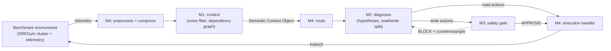

# Architecture (starting point)

This is where we start, not a final design. Change it when the work shows a better way, and record why in the PR.

## Principle
Read-only actions run freely. Every state-changing action passes M3 before it runs.

## Data flow
Telemetry enters through M4 (agreed 01/10/2026). The command path M2 → M4 → M3 is provisional.

*A thinking sketch, not a report figure. Report figures are drawn by hand in black and white.*

## Where each part lives

| Module | Folder | Owner | Entry point |
|---|---|---|---|
| M1 System Context Acquisition & Observation | `src/sre_agent/context/` | Minidu | `service.build_context` |
| M2 Multi-Hypothesis Diagnostic RCA | `src/sre_agent/diagnosis/` | Kaveen | `service.diagnose` |
| M3 Proactive Formal Verification Safety Layer | `src/sre_agent/safety/` | Saniru | `gate.check` |
| M4 Adaptive Tool Orchestration & Token Manager | `src/sre_agent/orchestration/` | Nethmi | `service.compress`, `service.execute`, `pipeline.run_once` |
| Shared contracts | `src/sre_agent/contracts/` | All four | see `docs/contracts.md` |
| Shared adapters, LLM access | `src/sre_agent/integrations/`, `src/sre_agent/llm/` | Shared | not built yet |

Folders use names, not module numbers, because the TAF and the proposal number M3 and M4 differently.

## Still open
- Orchestration framework: CrewAI or LangGraph. `pipeline.run_once` stays framework-agnostic until we choose.
- LLM provider and models for development and for the final evaluation.
- Contract v1 (the models in `contracts/` are a draft).
- System name. `sre_agent` is a placeholder package name.
- M3's policy for `unknown` and timeouts (fail-closed BLOCK for now).
- Whether the system keeps an undo step for failed mitigations, and which part decides that an incident is fixed.
